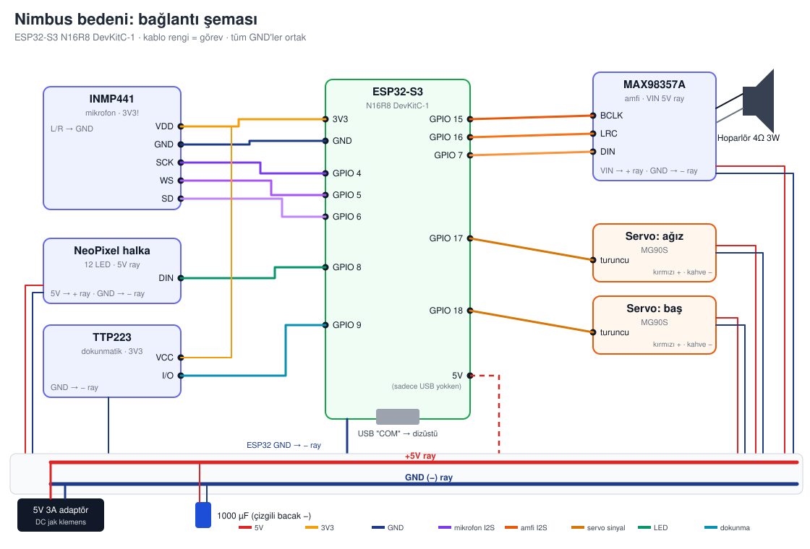

# Nimbus bedeni: bağlantı şeması

> ESP32-S3 N16R8 DevKitC-1 + INMP441 mikrofon + MAX98357A amfi + hoparlör + 2× MG90S servo + 12'li NeoPixel halka + TTP223 dokunmatik.
> Pin numaraları yazılımla aynı: [`esp32/src/main.cpp`](esp32/src/main.cpp). Parça listesi: [`ALISVERIS.md`](ALISVERIS.md).



## Önce bil

- **ESP32'yi breadboard'a takma.** Kart geniş, breadboard'u kaplıyor. Pinlerinden **dişi-erkek** kablolarla breadboard'a bağlan.
  Breadboard'u sadece güç rayları (+5V / GND) ve modüller için kullan.
- **3V3 ile 5V'i karıştırma.** Mikrofon ve dokunmatik **3V3**'e, amfi, servolar ve LED halka **5V raya** bağlanır.
- **Tüm GND'ler ortak.** ESP32'nin GND'si de breadboard'daki GND rayına bağlanmalı, yoksa servolar titrer, ses cızırdar.
- **Geliştirirken** ESP32 USB ile dizüstüne takılı. Bu sırada 5V rayı ESP32'nin `5V` pinine **bağlama** (sadece GND ortak).
  Dizüstüsüz çalıştırmaya geçince USB'yi çıkar, raydaki 5V'i ESP32'nin `5V` pinine bağla.
- USB kablosunu kartın **"COM" / "UART"** yazan girişine tak (diğeri "USB").

## Güç

| Nereden | Nereye |
|---|---|
| 5V 3A adaptör → DC jak klemens **+** | Breadboard **+ (kırmızı) ray** |
| DC jak klemens **−** | Breadboard **− (mavi) ray** |
| 1000 µF kondansatör uzun bacak (+) | + ray |
| 1000 µF kondansatör çizgili bacak (−) | − ray (ters takma: kondansatör patlayabilir) |
| ESP32 **GND** | − ray |

## Mikrofon: INMP441

| INMP441 | ESP32 |
|---|---|
| VDD | **3V3** |
| GND | GND |
| SCK | GPIO **4** |
| WS | GPIO **5** |
| SD | GPIO **6** |
| L/R | GND |

Mikrofon deliği (küçük delik) dışa, konuşan kişiye baksın; hoparlörden olabildiğince uzak olsun.

## Ses: MAX98357A + hoparlör

| MAX98357A | Nereye |
|---|---|
| VIN | + ray (5V) |
| GND | − ray |
| BCLK | GPIO **15** |
| LRC | GPIO **16** |
| DIN | GPIO **7** |
| GAIN, SD | boş bırak |
| Hoparlör + / − | hoparlörün iki kablosu (yönü fark etmez, ama iki uç birbirine değmesin) |

## Servolar: MG90S (kahverengi = GND, kırmızı = 5V, turuncu = sinyal)

| Servo | Kahverengi | Kırmızı | Turuncu |
|---|---|---|---|
| Ağız / çene | − ray | + ray | GPIO **17** |
| Baş eğme | − ray | + ray | GPIO **18** |

Servo kollarını ilk açılış testinden **sonra** tak: ESP32 açılırken servoları orta konuma getirir, kolu o konumda tak.

## Işık: 12'li NeoPixel halka

| Halka | Nereye |
|---|---|
| 5V / VCC | + ray |
| GND | − ray |
| DIN / IN | GPIO **8** |

DOUT boş kalır. Halkanın pinleri lehimsizse 3 kablo lehimlenmeli.

## Dokunma: TTP223

| TTP223 | ESP32 |
|---|---|
| VCC | **3V3** |
| GND | GND |
| I/O (SIG) | GPIO **9** |

Dokununca: uykudaysa uyanır, konuşuyorsa susar (sözünü kesip konuşabilirsin). **1,2 sn basılı tut**: vedalaşır.

## Lehim gereken yerler (tanıdığına götür)

| Parça | Ne lehimlenecek |
|---|---|
| INMP441 | 6'lı pin başlığı |
| MAX98357A | 7'li pin başlığı + hoparlör klemensi (2 pin) |
| NeoPixel halka | pinleri yoksa 3 kablo (5V, GND, DIN) |
| TTP223 | pinleri yoksa 3'lü başlık |

Hepsi birlikte ~15 dakikalık iş. Pin başlıkları modülün **arka yüzüne**, kısa uçları modüle gelecek şekilde lehimlenir.

## İlk çalıştırma (sırayla)

1. `.env` dosyasına Wi-Fi bilgilerini ekle (ESP32 sadece **2.4 GHz** ağa bağlanır; telefon hotspot'u da olur):
   ```
   NIMBUS_WIFI_AD=ag-adi
   NIMBUS_WIFI_SIFRE=sifre
   ```
2. ESP32'yi USB ile tak ve yükle: `./n esp32-yukle`
   Açılışta: halka gökkuşağı gibi yanar, ağız açılıp kapanır, baş sağa sola döner, hoparlörden "bi-dip" sesi gelir.
   Seri ekranda `mikrofon seviyesi` yazar; konuşunca sayı yükselmeli.
3. Seri ekranı Ctrl+C ile kapat, Nimbus'u ESP32 ile başlat: `./n --esp32`
   Halka turuncudan maviye dönerse bağlandı. Dokun ya da Enter'a bas: Nimbus uyanır.

Windows ilk seferde "Python ağa erişmek istiyor" diye sorar: **Özel ağlar**'a izin ver, yoksa ESP32 bağlanamaz.

## Işıklar ne diyor?

| Halka | Anlamı |
|---|---|
| Sarı dönen nokta | Wi-Fi aranıyor (ad/şifre ya da 2.4 GHz kontrol et) |
| Turuncu yanıp sönme | Wi-Fi var, Nimbus bulunamadı (dizüstünde `./n --esp32` çalışıyor mu, aynı ağda mı?) |
| Yavaş mavi nefes | Uykuda |
| Beyaz, konuşurken parlıyor | Sohbet |
| Sarı / kırmızı / mor / dönen mavi | Gülüyor / sitem ediyor / şaşırdı / düşünüyor |

## Sorun giderme

| Belirti | Çözüm |
|---|---|
| Ses yok | Amfi VIN 5V rayda mı? DIN GPIO 7'de mi? `.env`'e `NIMBUS_ESP32_SES=90` ekleyip yeniden yükle |
| Nimbus duymuyor | Seri ekranda mikrofon seviyesi konuşunca yükseliyor mu? Yükselmiyorsa SCK/WS/SD kablolarını kontrol et; çok düşükse `.env`'e `NIMBUS_ESP32_MIK_KAYDIR=11` |
| Servo titriyor / ESP32 yeniden başlıyor | Kondansatör takılı mı? GND'ler ortak mı? Servolar ESP32'den değil raydan mı besleniyor? |
| Ağız ters yöne açılıyor | `.env`'e `NIMBUS_ESP32_AGIZ_KAPALI` ve `NIMBUS_ESP32_AGIZ_ACIK` açılarını yaz (örn. 90 ve 120), yeniden yükle |
| Turuncu ışıkta kalıyor | Otel/etkinlik Wi-Fi'ı cihazları birbirinden yalıtıyor olabilir: telefon hotspot'u kullan. Ya da `.env`'e `NIMBUS_ESP32_SUNUCU=<dizüstü IP>` yaz (`./n --esp32` açılışta IP'yi yazar) |
| Yükleme başlamıyor | Kartta BOOT tuşuna basılı tut, RST'ye bas bırak, BOOT'u bırak, tekrar `./n esp32-yukle` |
